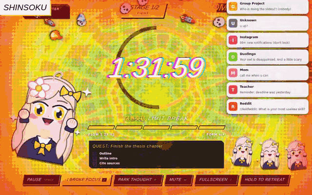

# Shinsoku (神速)

An intense, anime-flavoured focus app for **any** task: study, work, coding, gaming, reading, creating.
Pick a mode, start a session, and your power form climbs the longer you stay in flow, while the music,
visuals and a cheeky mascot (Soku-chan) get louder, faster and more chaotic with you.

> **Photosensitivity warning:** the visuals flash, shake and glitch in time with the beat, and the popups are
> deliberately chaotic. Set *Visual intensity* to **Chill** on the menu if that is a problem. The app also tones
> down motion if your system asks for reduced motion.

## Demo



<p align="center">
  
  
</p>

*Screenshots and the GIF were captured at higher forms with the clock sped up (`/?speed=120`). The first minutes are much calmer.*

## Features

- **Power forms:** BASE FORM → AWAKENED → SUPER → ULTRA → LIMIT BREAK as your uninterrupted flow time grows (5 / 15 / 30 / 60 min).
- **Procedural beat music** synthesised with WebAudio (no audio files). Five styles, drums from the first second, more layers per form.
- **Your own music from YouTube:** search for songs or whole playlists (or paste a video, playlist or live-radio link) on the setup screen, click a result to play it and keep going through the results, or add songs to a queue. The player follows you into the session, with previous / pause / next, a search button and a ↗ button that opens the current song or playlist on youtube.com, and your queue is remembered. Search uses public Piped servers, which can be down; add a free YouTube Data API key under *More options* to make it reliable. Some videos and playlists (often official label music) block embedding: with Docker, the small `shinsoku-api` helper then plays their audio through your own server instead (see below); without it, the player offers to open them on youtube.com. The visuals can't react to YouTube audio, and linking music turns the built-in beat off.
- **Lobby music and a victory fanfare**, also synthesised: a calm looping tune on the menu (starts after your first click) and a win fanfare on the results screen that gets bigger with your grade (S is the biggest; a retreat gets a sad little descent). One switch on the setup screen turns both off.
- **Audio-reactive WebGL background:** tunnel, kaleidoscope, speed lines, glitch rows, screen shake. 2D canvas fallback.
- **Soku-chan**, an original anime-style SVG mascot (long wavy hair, flower hairpin, school blazer) with a dozen moods who dances to the beat, trolls you, and flies in for cut-ins.
- **Popups, a lot of them:** floating numbers, stickers, achievements, fake error windows, fake live chat, emoji rain, warning tape.
- **Fake notification spam that scales with your form:** 2 per wave every ~10 s at BASE, up to 10 per wave every ~1 s at LIMIT BREAK (Chill intensity keeps it light).
- **Modes:** Study, Deep Work, Gaming, Creative, Reading, Custom (they only set defaults, none changes how the app behaves).
- **Score, XP and levels**, daily streak, parking-lot for distracting thoughts, objectives checklist.
- **Leaving the tab does nothing.** There is no tab-leave detection or penalty, by design.

## Run it

```bash
docker compose up -d --build
# open http://localhost:8899
```

This starts two containers: `shinsoku` (the app) and `shinsoku-api`, a small helper that uses [yt-dlp](https://github.com/yt-dlp/yt-dlp) to play songs whose owners block YouTube's embedded player. It updates yt-dlp on every start and daily, because YouTube changes often. If YouTube ever asks your server to "confirm you're not a bot", put a cookies file at `api-data/cookies.txt`. Note that playing YouTube audio outside YouTube's own player goes against YouTube's terms; the helper only kicks in for songs that can't be embedded, and the app works without it.

Add `?debug` to the address to log every player step to the browser console and to `docker logs shinsoku`.

Or for development:

```bash
npm install
npm run dev
```

The dev server runs the app only, not the `shinsoku-api` helper, so songs that block embedding fall back to the "Play it on YouTube" pop-up.

Tip: open `/?speed=60` to run the clock 60x faster when testing.

## Keyboard shortcuts (during a session)

| Key | Action |
|---|---|
| `Space` | Pause / resume (costs one form; disabled in Hard mode) |
| `B` | "I broke focus": log a miss (drops one form) |
| `P` | Park a distracting thought |
| `M` | Mute |
| `F` | Fullscreen |

## Stack

React 18, Vite, Mantine 7, WebGL, WebAudio. All progress is stored in your browser's `localStorage`.

## License

[MIT](LICENSE)
